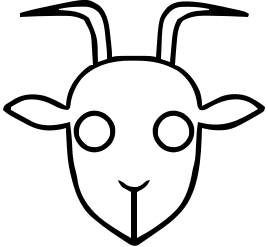
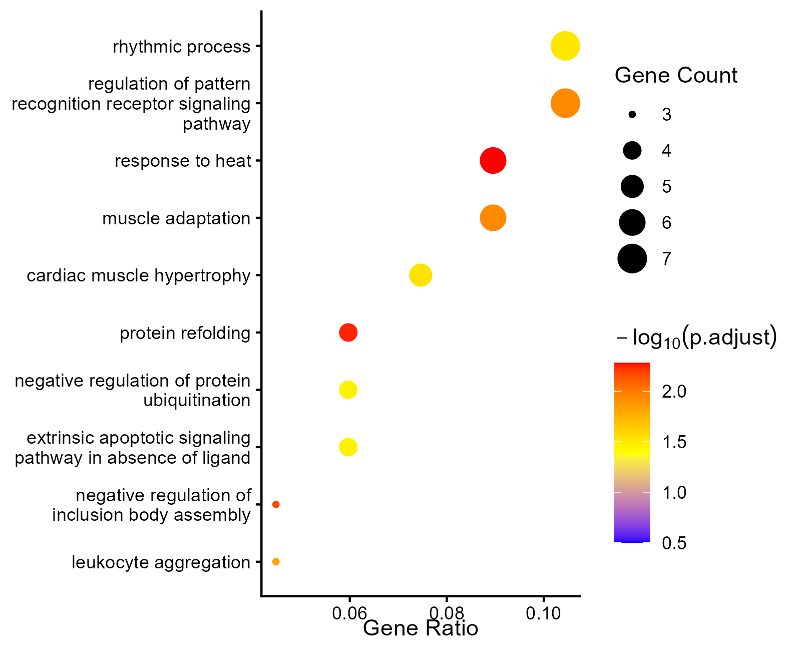
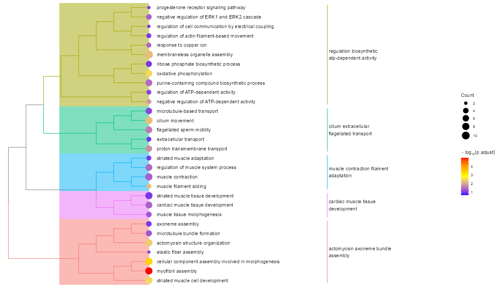
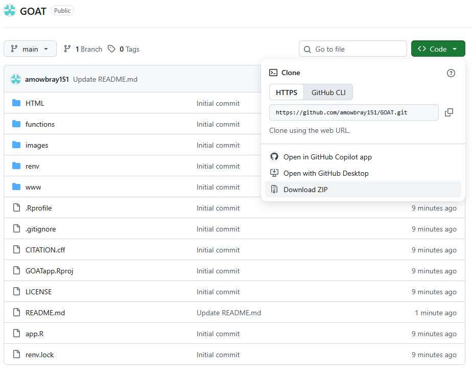

<p align = "center"></p>

 

# 

### Gene Ontology Analysis Tool, made with Shiny 

Welcome to GOAT! This ShinyApp uses the clusterProfiler package for R to run Over-Representation Analysis (ORA) GO enrichment. The enrichplot package is used for plotting functions. Supported organisms include:

- Homo sapiens

- Mus musculus

- Rattus norvegicus

- Saccharomyces cerevisiae

- Drosophila melanogaster

<p align = "center">

<br>
<br>

</p>
 

### Why should I use this tool over any other?

This tool runs clusterProfiler, making it highly customizable. It is also easy to make publication-quality plots.

 

Other web-based apps do exist for clusterProfiler, such as NASQAR2 and are equally as customizable, so within clusterProfiler interfaces, it is ultimately up to you on which you choose.

 

I also recommend running your enrichment on other softwares. There is a lot of variance between softwares due to annotation databases and mapping algorithms, so the results in one are unlikely to match another. Some examples of other softwares to try are:

 - GOShiny

- PANTHER

- g:Profiler


## Instructions

### Requirements

- R 4.6 (RStudio optional) <https://www.r-project.org/>
  
- rtools45 <https://cran.r-project.org/bin/windows/Rtools/rtools45/rtools.html>.

- An internet connection for the first install, to download packages


### First Time Setup

1. Download or clone the repository:

```bash

git clone https://github.com/amowbray151/GOAT.git

```
<p align = "center"></p>

2. Open the `GOAT` folder as a project in RStudio (or start R with the `GOAT` folder as your working directory). `renv` activates automatically.

You can do this by typing into the R console:

```r

setwd("Path/To/Extracted/GOAT-main")

```

For example:

```r

setwd("C:/Users/john/Downloads/GOAT-main")

```

3. (optional) Run the following command in the console to verify rtools45 installation:
```r
Sys.which("make")                  # should point into rtools45\usr\bin
system("g++ --version")            # should print a version, not an error
```


4. Install the required packages. In the R console, run:

```r

install.packages("renv")
install.packages("BiocManager")

renv::restore()

```
This may take several minutes.

Some errors might crop up when installing Bioconductor packages like GO.db. Installing them manually may be required:

```r
# E.g.
if (!require("BiocManager", quietly = TRUE))
    install.packages("BiocManager")

BiocManager::install("GO.db")
```


### Running the app

In the R console, run:

```r

shiny::runApp()

```
